


 

 

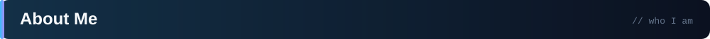

I'm a **Computer Science & Engineering student** at **Daffodil International University** (Dhaka, Bangladesh). My main interest is **Machine Learning and NLP**, and I pair it with solid **backend engineering** (Python, FastAPI, Django, Docker) so models can grow into usable software, not just notebooks. Currently preparing for the **ITPEC FE** exam and **JLPT** (Japanese).

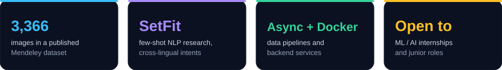

  

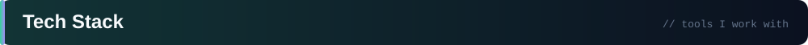

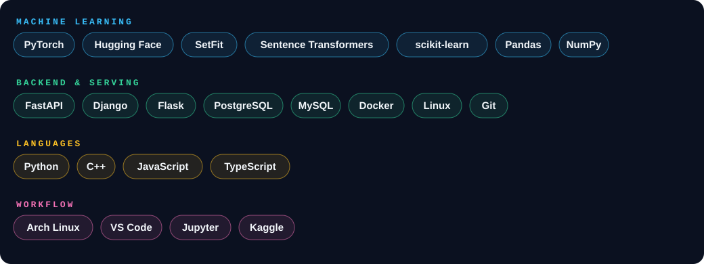

  

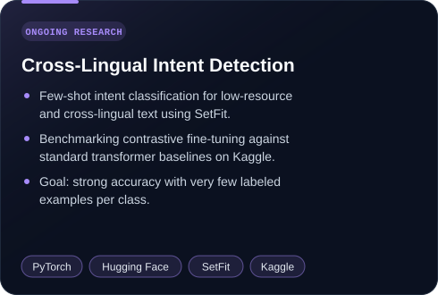
<a href="https://data.mendeley.com/datasets/c2hvz3t6t9">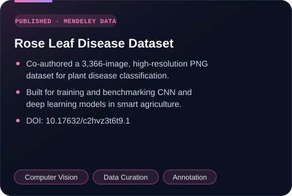</a>

 

<a href="https://github.com/jihad-islam?tab=repositories&q=churn">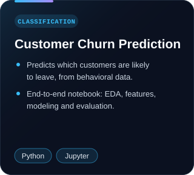</a>
<a href="https://github.com/jihad-islam?tab=repositories&q=vehicle">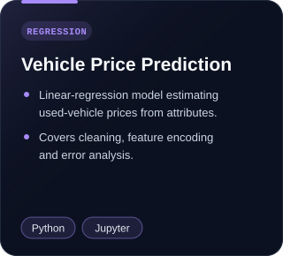</a>
<a href="https://github.com/jihad-islam/Home-Credit-Default-Risk">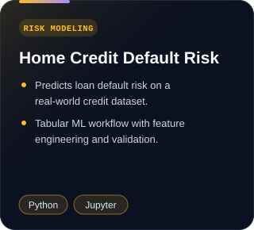</a>

 

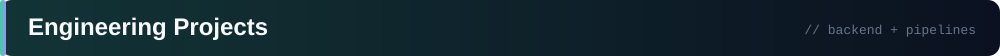

<a href="https://github.com/jihad-islam/TeleFlow-Downloader">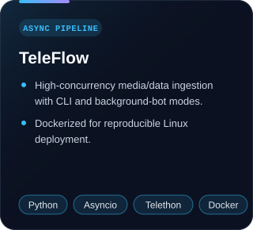</a>
<a href="https://github.com/jihad-islam/MCQ-Mate">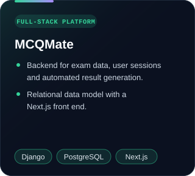</a>
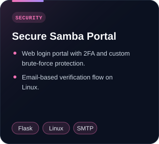

 

 

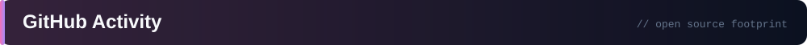

 

 

